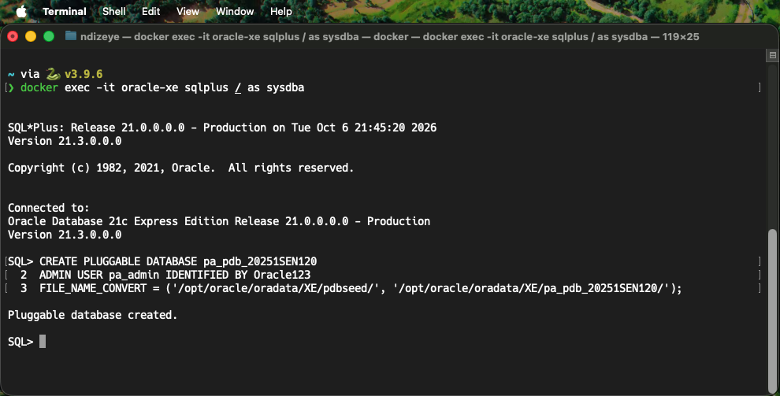
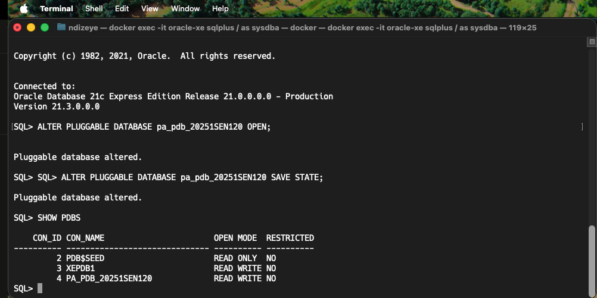
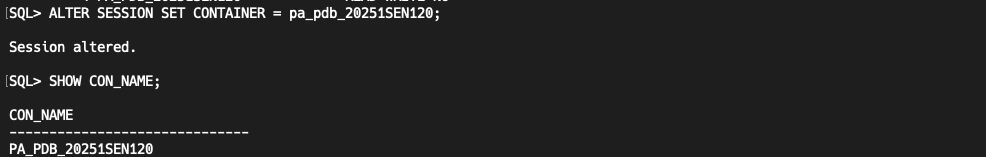
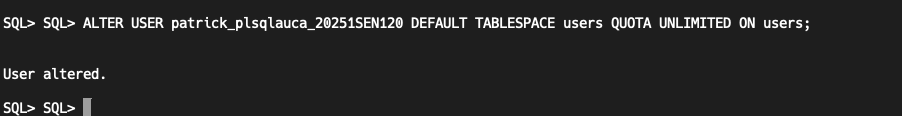
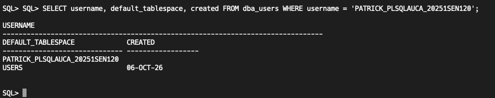
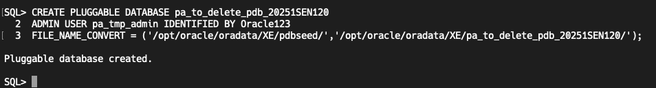
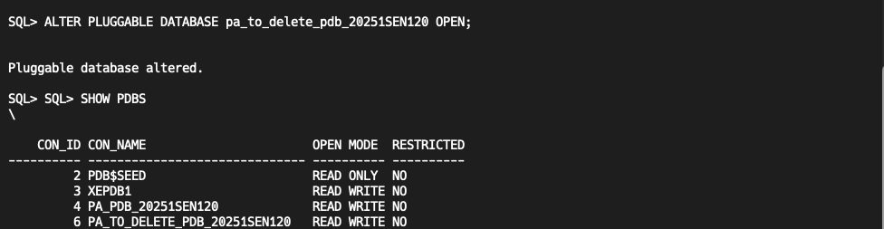
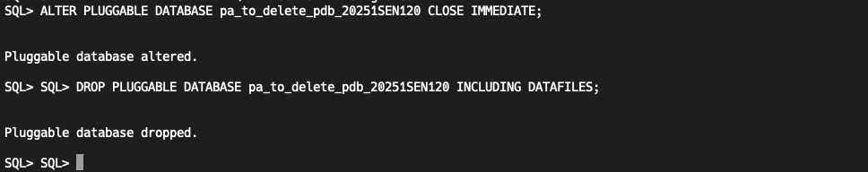
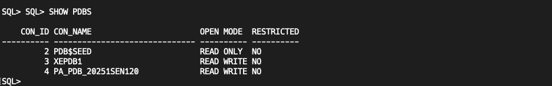
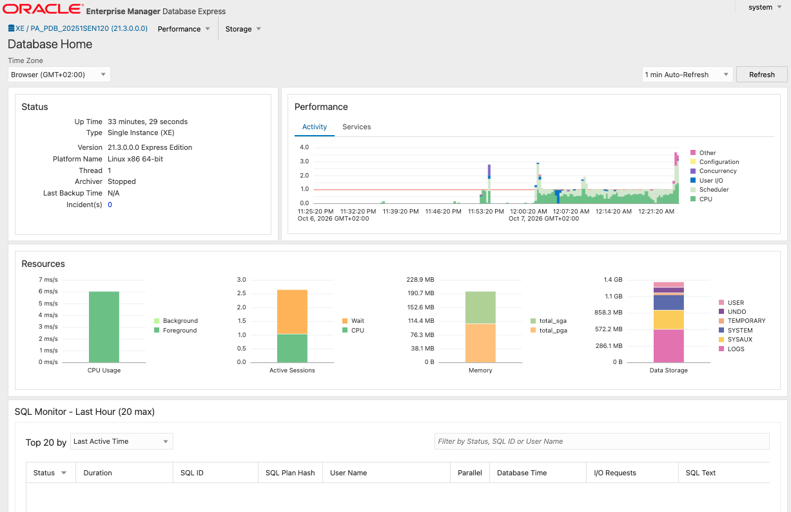

# Oracle PDB Assignment II — Patrick (20251SEN120)

## Overview of Tasks

<!-- TODO: your own words -->

## Oracle Environment Used

<!-- TODO: your own words -->

## Task 1: Create a New Pluggable Database

<!-- TODO: your own words -->

## Task 2: Create and Delete a PDB

<!-- TODO: your own words -->

## Task 3: Oracle Enterprise Manager (OEM)

<!-- TODO: your own words -->

## Challenges Faced and Solutions

<!-- TODO: your own words -->

## Integrity Statement

<!-- TODO: your own words -->

## Submission Details

- **Repository Link:** https://github.com/PATRICKNDIZEYE/oracle_pdb_ass_II_20251SEN120_patrick
- **PDB Name Created:** pa_pdb_20251SEN120
- **Issues Encountered:** Yes
